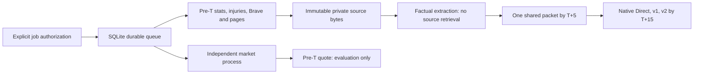

# Deployment: prospective cloud news v1 (not activated)

Use a small persistent Ubuntu24.04 VM, one host, an encrypted block volume mounted
as local ext4 (not a shared filesystem), systemd and
SQLite WAL. Source/model captures live in `/var/lib/nba-cloud-news`, owned by a
dedicated user, mode0700. It must survive process/VM restart. Do not use an
ephemeral runner, NFS/WAL sharing, multiple active VMs or a fresh empty directory
to bypass claims. VM deletion/disk loss is not tolerated automatically. Keep
encrypted/provider-protected backups of the entire state, caches, circuits and
request ledger. A stale restore requires operator reconciliation before paid work.

GitHub explicitly documents schedule delays and dropped queued jobs under high
load; its hosted runners also require external durable state. A persistent VM is
the simpler fit for this bounded worker. No GitHub workflow was enabled.
[GitHub schedule limitations](https://docs.github.com/en/actions/how-tos/troubleshoot-workflows).



Illustrative infrastructure: DigitalOcean's1GiB/1vCPU/25GiB basic VM is$6/month;
2GiB is$12 if concurrency/memory measurements require it. Weekly basic backups
add20% ($1.20 on the$6 plan); storage/egress/tax and other backup policies may add
costs. These are listed estimates, not a deployment or invoice.
[Official VM prices](https://www.digitalocean.com/pricing/droplets),
[backup prices](https://docs.digitalocean.com/products/backups/details/pricing/).
For private state, a20GiB volume adds$2/month at$0.10/GiB-month; volume snapshots
are additional. DigitalOcean documents volume/snapshot encryption at rest. A
practical starting estimate is$8/month plus backups/tax/overages, not just the VM
price. Keep secrets on encrypted storage or an operator-managed secret store.
[Volume pricing](https://docs.digitalocean.com/products/volumes/details/pricing/),
[volume encryption](https://docs.digitalocean.com/products/volumes/details/features/).

## Prepare the host after separate deployment permission

The following commands are **instructions only**. None were executed by this
implementation task. Obtain a VM/SSH target, disk/backups and operator approval
first. Use a full checkout at the tested commit. Do not copy the Mac pilot's
active job, change its installed timers or import its authorization as cloud consent.

```sh
# On the cloud VM, as an administrator.
sudo -i
sudo adduser --system --group --home /var/lib/nba-cloud-news nba-cloud
sudo install -d -m 0700 -o nba-cloud -g nba-cloud /var/lib/nba-cloud-news
sudo install -d -m 0700 /etc/nba-cloud
# Before initialization: mount the provisioned encrypted state volume at
# /var/lib/nba-cloud-news, add its persistent fstab entry, then set owner/mode.
sudo timedatectl set-timezone UTC
sudo timedatectl set-ntp true
timedatectl show -p NTPSynchronized --value
# Require "yes" before activation. Verify local persistent mount with findmnt.
findmnt -T /var/lib/nba-cloud-news

# Put repository at /opt/nba-forecasting; pin the reviewed commit, no auto-pull.
git clone https://github.com/Kiwiegg/prediction-market-forecasting.git /opt/nba-forecasting
cd /opt/nba-forecasting
git checkout REVIEWED_COMMIT
# The service user reads this root-owned checkout for precommitted asset checks.
sudo git config --system --add safe.directory /opt/nba-forecasting
python3 -m venv .venv
.venv/bin/pip install -r requirements.txt
.venv/bin/python -m unittest discover -s tests -q
.venv/bin/python scripts/cloud_prospective.py --replay-public reports/prospective_cloud_news_v1/simulation
sudo -u nba-cloud .venv/bin/python scripts/cloud_prospective.py --state /var/lib/nba-cloud-news --init
```

Code/venv should be readable, not writable, by `nba-cloud`; state is writable only
there. Confirm the store UUID printed at initialization. Use a trusted local
editor, never shell tracing or command-line key arguments:

```sh
# Keep environment files on the encrypted state volume, root-readable only.
sudo install -d -m 0700 -o root -g root /var/lib/nba-cloud-news/host-secrets
sudo mount --bind /var/lib/nba-cloud-news/host-secrets /etc/nba-cloud
# Add the corresponding bind mount to fstab after the state-volume mount.
sudoedit /etc/nba-cloud/secrets.env
sudoedit /etc/nba-cloud/storage.env
sudo chmod 0600 /etc/nba-cloud/secrets.env /etc/nba-cloud/storage.env
```

`secrets.env` contains `NBA_CLOUD_STORE_UUID`, `BRAVE_SEARCH_API_KEY`,
`ANTHROPIC_API_KEY`. `storage.env` contains only `NBA_CLOUD_STORE_UUID`. Do not
commit them. No model credentials are supplied to the independent market service.
No service starts until `/etc/nba-cloud/activated` exists. Never initialize a
new store to recover an uncertain paid attempt. The UUID must match the original
authorization; secrets and activation marker are not backups of the ledger.

## Exact first-game activation sequence — future explicit authorization only

First capture upcoming schedules under explicit no-cost network permission. One
catalog per UTC date is allowed; a failed/denied slot is not retried, and source
host circuits persist across dates. Workers never invoke discovery/enrollment
automatically. From the verified catalog, select the first future collection
window by target then game ID. Do not guess IDs or reuse expired ones. Excluded
legacy pilot ID401909861 is always refused. Set only one game and total$1.35 cap
initially.

```sh
# Same pinned checkout, run as nba-cloud (or sudo -u nba-cloud).
.venv/bin/python scripts/cloud_prospective.py --state /var/lib/nba-cloud-news \
  --discover --allow-network
# Review /var/lib/nba-cloud-news/discovery/YYYY-MM-DD/discovery.json (UTC date).
.venv/bin/python scripts/cloud_prospective.py --state /var/lib/nba-cloud-news \
  --authorize --game-id UPCOMING_ESPN_ID --max-usd 1.35 --confirm-authorized-cloud-game
# Save the printed authorization ID; no paid request has happened yet.
.venv/bin/python scripts/cloud_prospective.py --state /var/lib/nba-cloud-news \
  --enroll /var/lib/nba-cloud-news/discovery/YYYY-MM-DD/discovery.json --authorization AUTH_ID
# Ensure collection start is still in the future; review the immutable job JSON.

sudo cp deploy/cloud-news/nba-cloud-evidence.service /etc/systemd/system/
sudo cp deploy/cloud-news/nba-cloud-market.service /etc/systemd/system/
sudo systemctl daemon-reload
# These next commands activate bounded paid work and require explicit approval.
sudo touch /etc/nba-cloud/activated
sudo systemctl enable --now nba-cloud-evidence.service nba-cloud-market.service
```

No auto-enroller or recurring paid discovery is installed. Explicit allowlisted
jobs are scanned every2s with separate evidence/market thread pools. Each stage
has a durable claim and lock. Paid sends are serialized globally so a first
denial closes the circuit before another send; slow queued requests may miss their
deadline and remain ineligible. This is not a guarantee of precise scheduling or
API availability. Stage failures/unknown claims are not retried by systemd restart.

For a later authorized multi-game deployment, list additional verified IDs in one
bounded authorization, increase its total budget explicitly, enroll only future
collection windows, and assess concurrency/storage/clock health before starting.
Do not flip a campaign flag or silently turn this integration protocol into the
original100-game study. Use separate labeled cohorts and a reviewed stopping plan.

## Monitor, replay, pause and recover

```sh
systemctl status nba-cloud-evidence.service nba-cloud-market.service
journalctl -u nba-cloud-evidence.service -u nba-cloud-market.service
.venv/bin/python scripts/cloud_prospective.py --state /var/lib/nba-cloud-news
.venv/bin/python scripts/cloud_prospective.py --state /var/lib/nba-cloud-news --resources JOB_ID
.venv/bin/python scripts/cloud_prospective.py --state /var/lib/nba-cloud-news --replay JOB_ID
```

Status includes per-stage state, lane heartbeats, circuit IDs and research/forecast
reservations; resource audit separates tokens, latency and estimated costs. Alert
on stale heartbeats (>60s), failed/claimed stages beyond deadlines, any circuit,
low disk, NTP loss and missing freeze/seal. This ships local monitoring/CLI only;
configure an external uptime/disk alert destination before production. No outbound
alerts are sent by default. Do not log secrets or publish private raw responses.

Pause with `sudo systemctl stop nba-cloud-evidence nba-cloud-market` and remove
the activation marker. Preserve all claims, circuits, SQLite/WAL files and captures.
Never delete a failed attempt or change endpoint/cache identity to retry it.
Offline replay can verify completed artifacts; uncertain stages remain incomplete
for operator review. Back up with both services stopped, or use a consistent
SQLite backup plus an atomic snapshot of the matching captures/caches. Provider
Droplet backups do not include separately attached volumes; arrange volume
snapshots if using them. [Backup scope](https://docs.digitalocean.com/products/backups/details/features/).

The cloud VM, permissions, durable volume, NTP health, backup policy, secrets,
explicit first-game authorization and live provider access remain deployment
prerequisites. No cloud credential or host was provisioned/used in this task.
