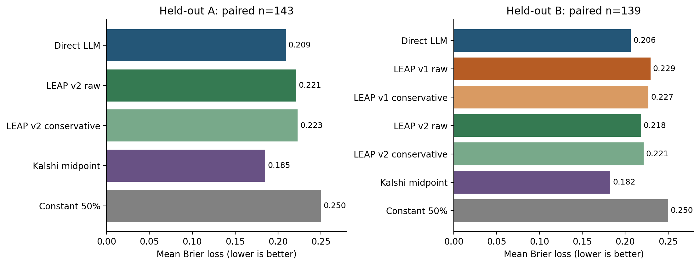
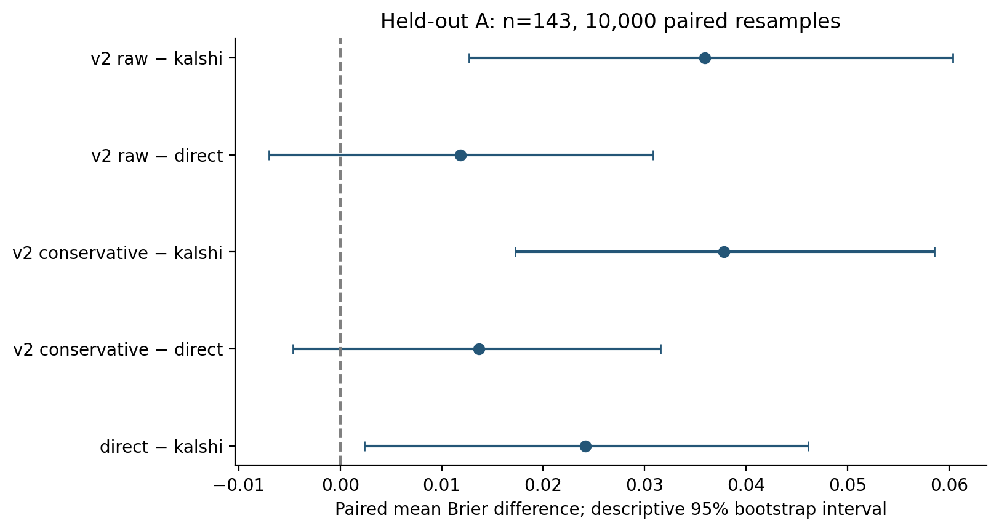
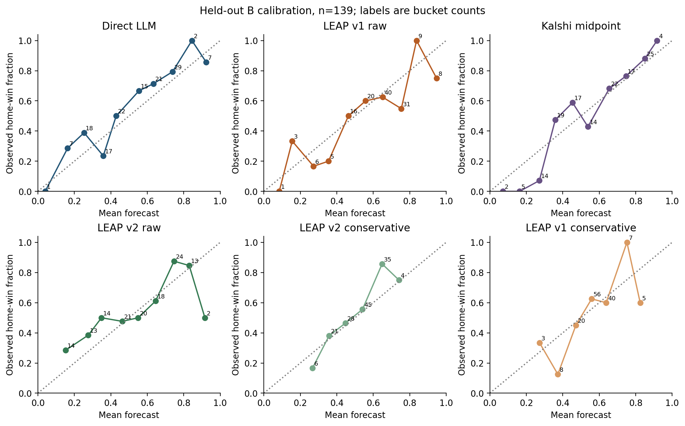
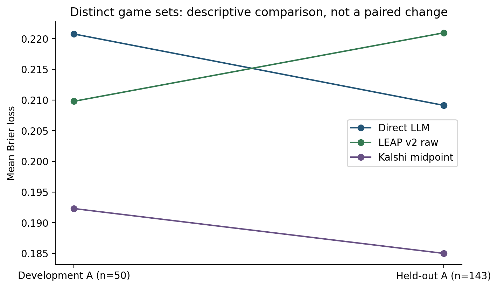

# Better Evidence Consistency Does Not Guarantee Better Forecasts

## Direct Probability Elicitation versus LEAP-Inspired Bayesian Aggregation for NBA Games

Research report · Kiwiegg/prediction-market-forecasting · November 2, 2026 reporting edition

**Status:** Historical experiments are complete. Prospective results below are an
interim, auditable update, not a completed 100-game study. The reporting deadline
is fixed in advance of further collection; this document does not assert that
November 2 has already elapsed. No publication acceptance or external peer review
is claimed.

### Abstract

Does asking a language model for evidence-level likelihood ratios improve its
probability forecasts? We compare direct home-win probability elicitation with
two LEAP-inspired methods on 200 NBA 2025–26 regular-season games, using shared
frozen evidence and a deterministic 50-development/150-evaluation split.
LEAP-NBA v1 elicits numerical ratios from four evidence groups; v2 uses blinded
team-strength evidence and qualitative judgments mapped to fixed ratios. Both
aggregate from a 50% prior, with raw and prespecified conservative variants.
Qualitative elicitation improves several synthetic consistency checks and reduces
weaker-team judgments in historical strength assessments. However, on the
143-game held-out primary intersection, v2 raw has Brier loss 0.220942 versus
0.209123 for Direct: a paired difference of +0.011819, with descriptive 95%
bootstrap interval [−0.007015, +0.030833]. Kalshi's independently joined midpoint
benchmark has Brier loss 0.184988 on those same games. V2 improves observed losses
over v1 on the separate 139-game seven-method intersection, without establishing
an advantage over Direct. Historical memorization, reconstructed source clocks,
dependent evidence and unequal inference resources limit interpretation. One
genuinely prospective T−24h capture validates the shared-packet workflow; its
outcome remains pending verification in the initial reporting snapshot. Evidence
consistency is useful for auditing but is not sufficient evidence of probability
accuracy or calibration.

### 1. Motivation and research questions

Probability forecasts express uncertainty rather than merely naming a winner.
An interpretable forecasting system should make it possible to inspect what
evidence was available, how it affected a probability, and what was missing.
Direct elicitation is simple: give a model the available evidence and request one
probability. Structured elicitation offers a different tradeoff: obtain local
assessments, then expose the aggregation arithmetic. LEAP separates evidence
assessment from deterministic probability combination [1]. This study asks
whether a small, reproducible NBA adaptation benefits from that separation.

The primary hypothesis is that v2 raw aggregation has lower paired mean Brier
loss than Direct on the untouched historical evaluation subset. Secondary
questions concern log loss, calibration, comparison with v1 and a market
benchmark, and sensitivity to a fixed shrinkage coefficient. A methodological
substudy asks whether blinded qualitative elicitation improves evidence-level
directionality, reciprocity and formatting stability. These are distinct
questions: consistency can improve even when forecast loss does not.

The project records negative results and operational failures alongside successful
forecasts. Its purpose is a controlled forecasting comparison, not a betting or
trading strategy. The historical evaluation is held out relative to this project's
development process; it is not claimed to be contamination-free.

### 2. Data, sampling and information boundaries

#### 2.1 Historical sample and split

The sampling frame contains 1,230 distinct regular-season games from October 21,
2025 through April 12, 2026, using US Eastern calendar dates. Thirty saved ESPN
team schedules are reconciled, requiring agreement between the two teams'
fixtures. Explicit canceled/postponed original fixtures and the NBA Cup
championship are excluded under the existing rules; distinct rescheduled event
IDs remain eligible. Two hundred slots are allocated proportionally across
months using largest remainders. Within each month, games are ranked by
SHA-256 of a fixed sampling seed and game ID. Outcomes, market prices and data
availability do not determine selection; unavailable observations are not replaced.

The split applies separate seeded, game-ID-based monthly ranking to allocate
exactly 50 development and 150 evaluation games. It is stratified rather than a
chronological future holdout. Development informed v2 design; the held-out
protocol and inference plan were committed before evaluation inference. The
canonical split hash is
`300d87a9dbd8165934e1571453eb15a03f93616841c4a450514d42cc75a94043`.
All methods use the same original game IDs and parent evidence hashes.

#### 2.2 Shared evidence

For each game, the intended information cutoff is recorded scheduled tipoff
minus exactly 86,400 seconds. Evidence consists of reconstructible season
wins/losses, up to five recent completed games, scoring differential, recorded
home/away splits and designation, rest measured at the cutoff, and eligible
official injury records. Historical news was intentionally not collected.

Statistics are rebuilt from individual completed games rather than retrospective
standings. The target game is excluded. A fact's conservative availability bound
uses the maximum of completion, recap publication/modification and event update
clocks. Missing history or inconsistent scores cause explicit omissions rather
than partial records presented as complete. Rest is time since the last
reliably completed game at the cutoff, not predicted rest at tipoff.

These are **retrospective reconstructions**. Later-retrieved timestamps do not
prove an unchanged historical payload or its first public availability. Zero of
the 200 games has an independently verified as-of schedule version. Injury
reports have official-origin timestamp support for 130/200 games and 1,047
player/status records; independently archived historical publication verification
and globally verified latest-report selection are both zero. Matching issue,
creation and official object clocks support a version timestamp, not proof that
the public could retrieve it then. Missing, not-yet-submitted and ambiguous
reports stay distinct; unlisted players are never inferred healthy. Report
presence does not necessarily imply usable target-team player evidence.

`evidence_packets.jsonl` is model-facing. Outcomes, market quotes, target scores,
raw provider responses and audit-only metadata are separate. Methods load the
same hash-verified snapshot; they do not independently research the game.
This prevents explicit label/price joins in inference, while not eliminating
remembered results or unobserved historical revisions.

#### 2.3 Outcome and Kalshi benchmark

Historical labels are finalized home-team YES market settlements with verified
home mapping. Kalshi prices are probabilities implied by market quotes, not
model inputs or guaranteed true probabilities. The preferred benchmark is the
midpoint of the newest valid two-sided YES candle ending at or before the cutoff,
with candle-end lag no more than 1,200 seconds and `0 < bid <= ask < 1`.
Conflicting newest ties remain missing; trades never replace missing quotes.

Exact-cutoff midpoints cover 114/200 games; valid quotes within 1, 5, 15 and 20
minutes cover 155, 187, 197 and 200 games respectively. Fresh last trades under
the separate 15-minute execution-age rule cover 156 games. The 20-minute rule
improves completeness without moving the prediction cutoff. It bounds
**candle-end lag**, not actual quote-update age, executability or the age of a
carried book value. Reliable quote-update clocks are unavailable. Market and
outcome joins occur only after inference is sealed. The prospective benchmark
instead uses an independently captured live quote at or before T, never a later
backfilled price.

### 3. Frozen forecasting methods

All model-based methods use `claude-haiku-4-5-20251001`, temperature 0, a maximum
of 128 output tokens, fixed versioned prompts and strict JSON validation. No
browsing, tools, additional retrieval, score prediction or lengthy rationale is
requested. Temperature 0 is not a guarantee of identical future provider output;
reproducibility here means replaying saved observations, identities and arithmetic.

**Direct LLM.** One request receives the full frozen packet and returns only a
finite `home_win_probability` in [0,1]. Invalid outputs and provider failures
remain missing. The prompt and settings were frozen before the pilot [P1].

**LEAP-NBA v1.** Four deterministic groups cover A: team strength, B: schedule and
venue, C: player availability, D: additional news. Each group receives only its
own evidence plus permitted identity/cutoff context. V1 asks for

`LR = P(group evidence | home wins) / P(group evidence | away wins)`.

The response includes an evidence-sufficiency label. Usable numerical ratios must
be finite and within [0.05,20]; invalid or insufficient outputs fail rather than
being silently clipped or neutralized. V1 strength includes team identities and
venue splits, while schedule uses designation and rest [P2].

**LEAP-NBA v2.** Strength is projected as Team X and Team Y, with deterministic
outcome-independent orientation and inverse mapping back to home/away. Names,
IDs, home designation and venue splits are excluded from strength. Venue splits
move to B; C retains validated injury/lineup evidence, and D only other eligible,
deduplicated developments. Other groups retain identities where required to
interpret player availability or schedule. All source qualifiers remain explicit.

Each usable group returns favored side, strength category and sufficiency.
Coherent categories map to fixed LR magnitudes: neutral 1, slight 1.25, moderate
1.75, strong 2.5, very strong 4; away/Y support uses reciprocals. `Insufficient`
is an abstention and makes the full forecast missing, not a neutral judgment.
Genuinely source-missing groups skip the request and contribute LR=1, with an
explicit reason [P3]. This makes no claim that unavailable evidence is actually
neutral in the world; it records no supported update from that group.

For both LEAP versions, with prior p0=0.5 and z_i=ln(LR_i),

$$
L = \operatorname{logit}(p_0) + \alpha\sum_i z_i,
\qquad p_{home}=\frac{1}{1+\exp(-L)}.
$$

Raw uses alpha=1; conservative uses alpha=0.5. Both reuse identical group outputs;
alpha is never fitted on these results. Failed required inference makes both
variants missing. Group removal is an offline recomputation from complete
forecasts, not extra inference or a replacement production method.

These are **LEAP-inspired adaptations, not an exact reproduction** [1]. The
original project protocol documents four fixed NBA groups, a neutral prior and
single assessments instead of implementing its broader dependency/reliability
machinery. Neither directly elicited nor mapped ratios are established calibrated
likelihood ratios. Independent-evidence Bayes would justify additive log ratios;
the actual groups are dependent. A tempered product exposes contributions but
does not prove valid Bayesian updating. Blinding, group boundaries, prompts and
mapping change together between v1 and v2, preventing causal attribution to any
one change.

### 4. Experimental design and analysis

The synthetic stage froze ten fictional matchup families, each with base, swapped
and formatting variants: 30 slots per arm, 27 unique requests after exact-cache
reuse. Both arms receive the same blinded inputs; the numerical arm is v1-style,
not a rerun of unblinded historical v1. Directional dominance, neutral identical
evidence, swap reciprocity, formatting stability and abstention are engineering
checks, not tests of win-probability calibration [P4].

The five-game historical pilots reuse a fixed development selection. Full
development follows with no held-out scoring. V1's earlier failures and
separately approved recovery lineage remain preserved: 40/50 development
forecasts are complete. V2 completes 50/50. The final historical evaluation was
precommitted at `3c420aff25a23f51afe823cc07b261fcddc4a7dc`; all inference sealed
before outcomes/quotes were joined. No model or mapping was tuned afterward [P5].

For outcome y in {0,1}, Brier loss is (p−y)^2 and natural-log loss is
−[y ln(p)+(1−y)ln(1−p)], with epsilon=1e−15 clipping for log loss only. These losses
reward honest probabilities in expectation under the proper-scoring framework
[2]. Calibration uses ten equal-width probability bins, reporting count, mean
forecast and observed home-win fraction. Classification accuracy is secondary;
home is selected when p>=0.5. Extreme probability means p<=0.1 or p>=0.9.

Primary analysis requires complete Direct and v2 raw forecasts and a verified
outcome. Cohort A additionally requires v2 conservative, Kalshi and constant 50%.
Cohort B additionally requires both v1 variants. Every comparison uses identical
game IDs within its named cohort; all excluded rows and reasons remain exported.
Missing model responses, legitimate source skips, abstentions and missing market
quotes are not imputed.

Uncertainty uses 10,000 paired game-row bootstrap resamples with replacement,
fixed seed 20261023, shared row indices within a cohort, and 95% percentile
endpoints using linear interpolation. Negative first-minus-second Brier
differences favor the first method. Intervals are descriptive: repeated teams,
dates and sources create dependence; multiple secondary comparisons and
historical contamination preclude strong significance or causal claims.

### 5. Results

#### 5.1 Consistency improves without guaranteeing forecast improvement

Both synthetic arms satisfy dominance directionality (15/15). Qualitative passes
swap direction consistency (8/8), populated-identical neutrality (3/3) and all
uninformative-evidence abstentions (6/6). Numerical elicitation scores 7/8, 0/3
and 6/6 respectively. Its identical-evidence cases abstain rather than return a
usable neutral estimate. On seven jointly usable swap pairs, exact reciprocity
is 7/7 qualitative versus 2/7 numerical. Formatting magnitude stability or paired
abstention is 10/10 versus 8/10. All 54 unique paid requests return valid schemas.

The qualitative mapping mechanically constrains magnitudes and reciprocals once
categories agree. These results demonstrate consistency on a small dependent
fixture suite, not calibration. A terse response cannot reveal unspoken invented
reasoning; zero unsupported output fields does not prove none occurred.

#### 5.2 Development findings

${Development_A}

*Table 1. Development A, the same 50 games for every row. Extreme p uses the fixed
0.1/0.9 thresholds. Development B, n=40, is included in the machine-readable tables.*

V2 raw minus Direct Brier is −0.010975 on development A, with interval
[−0.040927,+0.017961]. On the different 40-game seven-method intersection, v1 raw
Brier is 0.257588 versus v2 raw 0.213317; v1 raw is also worse than constant 0.5
there. These observations motivated diagnosis, not changes to the held-out
methods. Missing v1 forecasts must not be silently omitted from coverage.

#### 5.3 Primary held-out result

${Held-out_A}

*Table 2. Held-out A, identical n=143 for all rows. The primary Direct–v2 pair has
these same IDs because all held-out market quotes are available.*

The primary difference is **+0.011819 Brier**, v2 raw minus Direct. The interval
**[−0.007015,+0.030833]** spans modest improvement and deterioration; it does not
support the prespecified improvement hypothesis. V2 raw log loss is also higher
(0.635951 versus 0.607207). Kalshi has lower observed losses than both. This is
not a claim of universally superior market calibration or proof that LLMs lack
signal: all three have observed Brier loss below the constant baseline, subject
to the historical limitations.

*Figure 1. Mean losses, not separate-subset rankings. Panels use different game
sets and should not be interpreted as matched changes between panels.*

#### 5.4 Seven-method comparison and uncertainty

${Held-out_B}

*Table 3. Held-out B, identical n=139. Four additional v1 failures reduce the
intersection relative to A; scores from n=139 and n=143 are not paired estimates.*

V2 raw improves the observed v1 raw Brier by 0.011024 on these 139 games, but its
interval also crosses zero. V1's mean home probability is 0.626500 versus
0.528839 for v2 raw; these means alone are not a test of bias or calibration.

${Intervals}

*Table 4. Precommitted paired Brier intervals; secondary comparisons are not
adjusted for multiplicity. The duplicated primary/A comparison is intentional
because their eligibility definitions differ, although their observed IDs agree.*

#### 5.5 Calibration and shrinkage

*Figure 2. Ten equal-width bins; empty bins are omitted from lines but retained in
the CSV. Labels show counts. Small buckets produce unstable observed frequencies;
connected segments are descriptive rather than a fitted calibration function.*

Conservative v2 moves 132/143 held-out A probabilities closer to 0.5, leaving
11 unchanged. It eliminates the two raw extreme probabilities but raises Brier by
0.001828 and log loss by 0.001348. On development A it also raises both losses.
Less confidence is therefore not equivalent to improved calibration. No alpha
was selected or fitted after seeing either set.

*Figure 3. V2's observed development advantage over Direct does not persist in
held-out A. Different outcomes, evidence completeness and sample sizes prevent
interpreting this plot as a paired estimate of degradation.*

#### 5.6 Group diagnostics and missingness

${Groups}

*Table 5. Held-out observations by group. Success-only LR distributions exclude
source skips; accepted neutral judgments remain included. Failed/insufficient are
separate counts. Detailed category, sufficiency and log-contribution distributions
remain in the original diagnostic artifacts.*

The predefined statistical weakness criterion requires both lower season win
fraction and lower average differential. Of 47 common assessable held-out strength
observations, v1 favors the weaker side 16 times and v2 zero times; home-favoring
counts are 36 and 20. Ninety-four games lack sufficient/positive-game statistics
and eight have tied or discordant indicators; inference completeness imposes
further exclusions. Outputs were not corrected. Improved directionality is not a
forecast score and does not identify blinding as the cause.

Among 141 common successful strength/venue observations, contributions reinforce
in the same nonzero direction in 102 v1 cases and 87 v2 cases. Moving venue splits
does not remove their correlation with overall strength. On held-out A, removing
v2 raw strength, venue or injuries changes Brier by +0.014556, +0.004448 or
+0.001489 respectively (omission minus full); removing news changes nothing
because historical news was uncollected. These are offline sensitivity
calculations, not causal contributions or recommendations to retune the method.

In held-out evidence, 55 games have both teams reported, 31 one-sided submission,
12 neither yet submitted and 52 both unavailable. Sixty-four player-availability
groups have no usable source evidence and skip; v2 loses one of the 86 source-usable
availability requests to transport failure. These missingness patterns can affect
which games enter complete-case comparisons. No missing report implies health.

#### 5.7 Coverage, inference resources and failures

Held-out coverage is Direct 148/150, v1 144/150 and v2 144/150; Kalshi and constant
cover 150. The primary pair excludes seven games, and B excludes eleven. Eight
requests have transport failure with HTTP status 0 and unknown usage; three v2
responses abstain and three v1 responses fail the numeric insufficient-evidence
rule. These are not all provider HTTP failures. No held-out HTTP403, search,
evidence collection or automatic paid retry occurred.

| Held-out method | Requests | Successful games | Input / output tokens | Sum HTTP latency, seconds | Token-rate estimate / unknown reserve, USD |
|---|---:|---:|---:|---:|---:|
| Direct | 150 | 148 | 345,032 / 2,220 | 589.738 | 1.068396 / 0.065886 |
| V1 | 382 | 144 | 572,491 / 7,195 | 1,374.705 | 1.825398 / 0.110853 |
| V2 | 382 | 144 | 406,678 / 8,340 | 1,297.377 | 0.896756 / 0.048874 |

*Table 6. Costs use the original configured rates, not invoices: Direct/v1
USD3/USD15 and v2 USD2/USD10 per million input/output tokens.*

All 914 planned requests were attempted. Conservative reservations totaled
USD22.943654; reported-token estimates totaled USD3.790550 plus USD0.225613
unknown-usage reserves, or USD4.016163 recorded estimate. Wall-clock inference
was about 56 minutes; summed request latency is a different quantity. One Direct
call versus several group calls is an unequal inference budget. Different saved
rates also prevent treating these dollar estimates as a normalized efficiency
comparison. Historical development v1 access-denial failures remain preserved;
only separately approved lineage is used in the reported merged development set.

### 6. Prospective validation and publication update

#### 6.1 Fixed-information prospective protocol

The cloud-news-v1 protocol fixes T at recorded scheduled tipoff minus 24 hours.
Collection runs T−30 minutes through T; all included external source bytes must
be retrieved no later than T and satisfy existing publication/availability rules.
Only processing of immutable pre-T bytes occurs afterward. The shared packet must
freeze by T+5 minutes, all forecasts must seal by T+15 and before tipoff, and
late attempts remain ineligible. Extraction cannot browse after T. Market capture
is independent and never enters model context.

GitHub Actions dispatch is not a precise clock. Early startup, in-run waits,
durable private R2 checkpoints, atomic ownership and paid-request claims support
restart safety; actual deadline checks determine eligibility. An ambiguous paid
request is not automatically resent. Account/provider and official-source
denials remain fatal. These safeguards trade sample coverage for integrity.

#### 6.2 First eligible live observation

Brooklyn at Boston, game 401909877, was scheduled for October 27, 2026 at 23:30 UTC.
Its fixed T was October 26 at 23:30 UTC. Baseline collection began at 23:00:02.861;
refresh ended 23:28:06.566. The packet froze at 23:30:01.826 and forecasts sealed
at 23:30:44.585, within both deadlines. All methods use parent hash
`e7b0dc9502a0f374f6805bfa0ad16a947a4ce6d1aeff09d6d3f5cb09503c27de`.
Private replay reconstructed native requests, parsed raw responses and verified
all three methods individually [P6].

| Method | Boston home-win probability |
|---|---:|
| Direct | 0.9200000000 |
| V1 raw / conservative | 0.8614190687 / 0.7137287717 |
| V2 raw / conservative | 0.7928802589 / 0.6617690235 |
| Independently captured Kalshi midpoint | 0.8100000000 |

The quote was 0.80/0.82, captured 4.856 seconds before T; quote-update age is
unknown. Boston's official injury report was not yet submitted, while Brooklyn
had five reported Out statuses. The latest eligible observed official report was
issued 15 minutes before T. Missing submission was not converted to healthy
player evidence. Team histories comprised only two completed Boston and three
Brooklyn regular-season games, making early-season strength estimates uncertain.

Two Brave searches returned eight entries, but none passed article-path/duplicate
validation. There were **zero retrieved articles, accepted news claims or Claude
news-extraction calls**. This validates the empty-news path, not successful live
news extraction or the absence of relevant news. Seven model requests succeeded;
both news groups skipped explicitly. Total reserved budget was USD0.178331;
the saved configured-rate usage estimate was USD0.044619, with 8,661 input and
138 output model tokens. Neither amount is a verified invoice.

The original pilot audit remains immutable and unscored. Current reporting input:
**${Prospective_counts}**.

${Prospective_inventory}

${Prospective_scores}

*Table 7. This section is regenerated from an append-only update bundle. Pending
outcomes do not enter scores; failed captures never become observations merely
because an outcome is later known. A single scored game, if later verified,
would remain an implementation diagnostic rather than a skill estimate.*

#### 6.3 Operational failure is part of the result

The subsequent campaign paused after an AP News HTTP403 opened network and paid
circuits and retained worker ownership. Private audit reconciled 17 paid claims,
all with saved HTTP200 provider responses, and USD0.282501 retained reservations.
Four partial collections and two unstarted enrolled games missed deadlines and
cannot be recovered as eligible forecasts. Seven cumulative enrollment slots,
including the successful pilot, remain consumed. A configured cap of 30 attempts
therefore cannot guarantee 30 successful pairs; exact target count is not a
condition for reporting these results.

Review of the saved AP response, without refetching, identified a documented
Cloudflare browser challenge. A narrowly reviewed prospective amendment can treat
such a third-party article denial as missing evidence while permanently blocking
the host and retaining journals. It does not excuse provider credentials/account
failures or official-source denials. Authorized adoption and verification are
reported separately in `operations/policy_adoption.md`; live activation is a
separate decision. The original sources, claims and completed pilot are preserved.
The historical `SourceBudget.clock` failure was a separate earlier discovery bug,
not evidence that a later denied article succeeded [P7].

#### 6.4 Fixed November 2 update

The reporting cutoff is the end of November 2, 2026 in America/New_York:
**2026-11-03T05:00:00Z exclusive**, accounting for the November 1 daylight-saving
transition. Only eligible captures frozen and sealed before that boundary enter
this publication cohort. Every enrolled job is inventoried, with failure reasons;
there is no replacement or selection by forecast accuracy, outcome, market
availability or source completeness. Verified outcomes may be appended later with
their real retrieval clocks; pending results remain pending in an interim paper.

The offline update script reuses private replay and the existing final-outcome
parser, records source hashes, preserves prior forecast fields, and refuses to
overwrite a completed update bundle. No network or model request occurs during
report generation. Legacy, news-v1 and policy-amended observations stay labeled
and separately scored. This deadline-limited publication does not redefine,
complete or restart the original 100-game prospective study. No additional
collection is required for the present historical conclusion.

### 7. Limitations and threats to validity

**Historical contamination.** The model can use remembered team/game information
despite instructions. Model identifiers and blinding do not prove absence of
outcome knowledge. The held-out split controls this project's tuning, not the
model's training or knowledge. The results must remain exploratory historical
evidence until a substantially larger genuinely prospective sample exists.

**Source-time uncertainty.** Recorded ESPN schedules, later-updated recaps and
injury object metadata are not universally archived as-of facts. Conservative
omission protects against some leakage at the cost of nonrandom missingness.
Actual Kalshi quote-update age is unknown, and the 20-minute candle rule is not a
freshness guarantee. Different information access and market efficiency can affect
benchmark comparisons without establishing a causal explanation.

**Uncalibrated and dependent ratios.** Numeric LRs and category mappings are model
judgments rather than measured class-conditional densities. Strength, venue,
recent form and injuries overlap. Additive log ratios can double count evidence;
fixed alpha=0.5 reduces magnitude but is not a fitted dependence correction.
Qualitative outputs restrict expressiveness and mechanically aid reciprocity.

**Limited and unequal experiments.** Fifty development and 150 historical
evaluation games, dependent teams and small calibration bins limit precision.
V1/v2 revisions change multiple components. Inference resources differ across
methods. Complete-case exclusions can select a nonrepresentative subset, so all
coverage and denominators must accompany scores. The one eligible prospective
capture is operational validation, not a meaningful test of predictive skill.

**Deployment and measurement.** Scheduling latency, source access denial, early
injury submissions and publication-time rejection can prevent complete captures.
Transparent omissions are preferable to post-cutoff backfill. Hashes demonstrate
internal consistency, not independent provider authenticity. Private replay adds
raw-source/request checks, but neither public nor private replay reruns or proves
the determinism of model inference. Token-rate estimates are not paid invoices.

### 8. Conclusions and future work

On this frozen historical evaluation, structured qualitative elicitation improves
specific evidence-level diagnostics but does **not** improve the primary
probability-forecasting loss relative to Direct. Kalshi has the lowest observed
losses on the paired benchmark sets. V2's improvement over v1 is descriptive and
cannot isolate the cause. The important negative finding is that better local
consistency does not ensure calibrated aggregate probabilities.

The project delivers auditable shared inputs, immutable inference and missingness
records, and a prospective protocol that has produced one valid live observation.
Publication can proceed with the historical findings and explicit prospective
limitations rather than waiting for an arbitrary success count. Further work
should collect genuinely prospective observations under separately authorized,
fixed protocols; assess source missingness and dependence; and study calibrated
evidence combination using independent data. None of those changes is implemented
or tuned in this report, and held-out results must not become another tuning set.

### Reproducibility and availability

The public repository includes sanitized observations, exact paired IDs,
per-game losses, calibration bins, precommitted bootstrap results and source
hashes. `tables/` exports all four historical comparison cohorts plus the primary
pair and prospective strata. `figures/` contains reproducible PNG and SVG files.
No confidential provider body, key, authorization header or private R2 credential
is published. The original dataset and protocols are unchanged.

The accompanying README documents offline rebuilding, verified outcome updates
and PDF export. Source manifests pin the original result artifacts; generated
manifests detect accidental report changes. Reproduction means recomputation of
saved results, not fresh model inference. See `validation.json` for the final
test/replay and baseline-integrity checks, and the operational note for policy
adoption status. Authorship, affiliations and submission venue should be supplied
by the research owner before submission; they are not invented here.

### References

1. Chen, Y., Zhao, Y., Xu, X., Xie, Q., Wu, J., and Liu, Z. (2026).
   *LEAP: Likelihood Elicitation and Aggregation for LLM-based Probabilistic
   Forecasting*. arXiv:2609.01337v1. [Original paper](https://arxiv.org/abs/2609.01337).
2. Gneiting, T., and Raftery, A. E. (2007). *Strictly Proper Scoring Rules,
   Prediction, and Estimation*. Journal of the American Statistical Association,
   102(477), 359–378. [Author-hosted manuscript](https://sites.stat.washington.edu/people/raftery/Research/PDF/Gneiting2007jasa.pdf).

### Project protocols and empirical sources

- P1. [Frozen Direct protocol](../../experiments/direct_baseline_protocol_v1.md).
- P2. [Frozen LEAP-NBA v1 protocol and adaptation statement](../../experiments/leap_nba_v1_protocol.md).
- P3. [Frozen historical v2 protocol](../../experiments/leap_nba_v2_phase2/protocol.md).
- P4. [Synthetic Phase 1 observations and diagnostics](../leap_nba_v2_phase1.md).
- P5. [Precommitted held-out protocol](../../experiments/heldout_150_protocol.md),
  [complete held-out report](../heldout_150/report.md),
  [development report](../leap_nba_v2_development_50/report.md).
- P6. [Private-replay-verified prospective pilot audit](../prospective_live_pilot_1/report.md).
- P7. [Campaign accounting/recovery](../prospective_news_recovery_v1/report.md),
  [final saved-response denial review](../ap_news_denial_review_v1/report.md).
- [Historical reconstruction methodology](../dataset_methodology.md),
  [market coverage](../../data/nba_2025_26/coverage_report.md),
  [injury coverage](../../data/nba_2025_26/injury_coverage_report.md).
